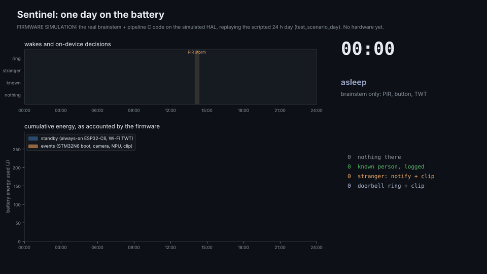
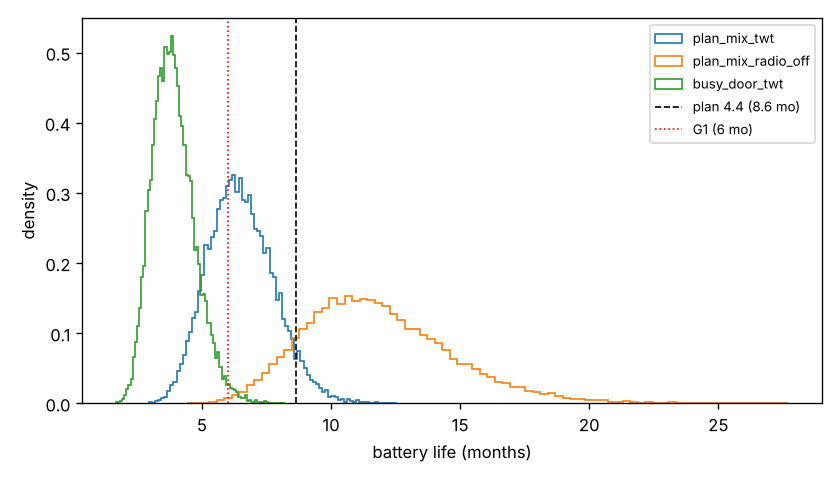

# Sentinel

A battery-powered edge-AI doorstep camera. It sleeps at tens of microamps, wakes on motion, and decides on the device whether it sees a person and whether that person is someone it knows. Only then does it spend energy on the radio. Models and firmware update over the air as signed A/B images, and the camera improves through on-device enrollment plus federated learning across a small fleet, so raw faces never leave the house.

The split that makes this work is a **brainstem** and a **cortex**:

- The brainstem is an always-on ESP32-C6 that watches the PIR and the doorbell button and keeps Wi-Fi associated with Target Wake Time.
- The cortex is an STM32N6 (Cortex-M55 + Neural-ART NPU). It is fully power-gated and is woken only to run person detection, face detection, face embedding and gallery matching.

**Status: phase 1 (everything that can be built and tested without hardware) is complete.** Phase 2 needs dev kits (STM32N6570-DK, ESP32-C6 DevKit, Nordic PPK2) and has not started. Every number below comes from models, simulations or synthetic data, as labelled.



*The firmware's scripted 24 h day (`firmware/core/tests/test_scenario_day.c`). The real brainstem and pipeline C code runs on the simulated HAL, covering:*

- *20 false wakes*
- *known people and strangers*
- *a doorbell ring during a clip*
- *a 20-minute PIR storm*
- *a low-battery refusal and a cold-cell brown-out*

*Energy is what the firmware itself accounts for. This is a **simulation**: no hardware exists yet. Regenerate it with `python3 tools/media.py`. [MP4](docs/media/day-reel.mp4)*

## What exists (phase 1)

| Area | What | Where |
|---|---|---|
| Hardware | Battery-life model with Monte-Carlo and sourced constants (single source of truth), Rev A BOM + checker, rail/sequencing spec, interface and I2C maps, Rev 0 bench wiring, layout rules, review checklist | [`hardware/`](hardware/README.md) |
| Firmware (C11, no malloc) | Brainstem power sequencer, wake fusion + PIR-storm limiter, event pipeline/policy, int8 gallery matcher, status/fault writer, simulated HAL, scripted day. Cross-compiles for Cortex-M55 and RV32 | [`firmware/core/`](firmware/core/README.md) |
| OTA + security | Signed A/B firmware and model slots (P-256), redundant metadata, anti-rollback, streaming writer. 2,000 randomized power cuts: 0 bricks | `firmware/ota/`, `tools/` |
| ML | Person detector, face detector, MobileFaceNet; QAT int8 export; NPU-fit checker; golden vectors shared with the firmware. **Synthetic data only** | [`ml/`](ml/README.md) |
| Backend | MQTT ingest, REST, clip storage, OTA notices, fault log, dashboard, device simulator, mTLS ACLs | [`backend/`](backend/README.md) |
| Federated learning | Non-IID home simulator, FedAvg/FedProx, DP with an RDP accountant, secure aggregation, Flower adapter | `fl/` |

## Key findings so far

- **Battery life (hardware model, the number of record):** the median is 6.4 months (p5–p95 4.6–8.7) with Wi-Fi kept associated, and 11.5 months with the radio off.
  - The biggest lever is the Wi-Fi TWT interval.
  - The most important number still to measure is the ESP32-C6's TWT current.
- **NPU energy is under 1% of an event.** Battery life is set by boot, sensor start-up and radio time, so the firmware minimises wake time rather than MACs.
- **The PIR-storm limiter matters.** In the scripted day, 400 pulses become 16 wakes instead of 100, about 6× less energy.
- **Federated learning (simulated):** federating and then fine-tuning locally cuts false alerts by about 22% compared with local-only, and still holds at DP ε ≈ 6.



*Battery-life distribution from the hardware power model (20,000 draws; `make -C hardware report`).*

## Running

```bash
make test                     # every workstream: firmware (plain + ASan/UBSan), tools, hardware, backend, FL, ML, integration
make -C hardware report       # battery-life report and figures
python3 tools/media.py        # regenerate the README animation (needs cmake, a C compiler, matplotlib, ffmpeg)
```

Design docs: [`docs/PLAN.md`](docs/PLAN.md), [`docs/SCOPE.md`](docs/SCOPE.md), [`docs/INTERFACES.md`](docs/INTERFACES.md).
